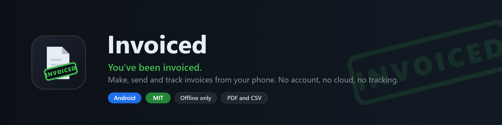

<p align="center">
  
</p>

<p align="center">
  <a href="https://github.com/REMvisual/youvebeeninvoiced/releases/latest">
    
  </a>
  <a href="https://github.com/REMvisual/youvebeeninvoiced/releases">
    
  </a>
</p>

<p align="center">
  
  
  
  
</p>

# Invoiced

You have been invoiced.

A deliberately small Android invoicing app. Make an invoice, send it as a PDF,
mark it paid, export everything to CSV. That is the whole app.

It was built because Invoice Simple and friends do a hundred things and we
needed six. No account, no subscription, no cloud sync, no analytics. The app
does not even have the internet permission. Your invoices never leave the phone
except as the PDF you choose to send.

## What it does

- **Invoices** with line items (description, quantity, unit price), a percent or
  fixed discount, and an optional add-on tax such as VAT, off by default.
- **Withholding.** If your clients deduct tax at source, set the rate once and
  every invoice shows the expected net you will actually receive. It stays off
  the client's PDF unless you switch it on for that invoice.
- **Send by email.** One tap opens Gmail, or any email app, with the client's
  addresses, subject, a short body and the PDF attached. The body is an
  editable template with placeholders.
- **Six PDF templates** (Classic, Modern, Minimal, Bold, Elegant, Compact),
  preset or custom accent colour, optional logo. Preview inside the app.
- **Sent, Updated, Paid.** Sending marks an invoice Sent. Change it afterwards
  and it becomes Updated with a new revision number, and the resend says so.
  Mark paid with the date and the amount actually received.
- **Clients** with several named recipients each, and **saved items** with
  prices. Both autocomplete on the invoice.
- **Backup.** Export all data (settings, logo, clients, items, invoices) to one JSON file
  and import it on a new phone.
- **CSV export** of all invoices and all line items, including gross,
  withholding, expected net and received, for whoever does your books.

## Install

1. Open the [latest release](https://github.com/REMvisual/youvebeeninvoiced/releases/latest)
   on your phone and download the `.apk`.
2. Open the file. Android asks once to allow installs from your browser.
3. Updates install over the old version and keep your data.

Needs Android 8.0 or newer. Not on the Play Store, and not planned to be.

## First run

Open Settings from the gear icon and fill in your business details, payment
instructions and default rates. Pick a template and colour. Then tap
**New invoice**.

## Privacy

- No internet permission. The app cannot talk to any server.
- Data lives in a local database on the phone. The CSV export is your backup.
- PDFs and CSVs are written to the app's private cache only when you share them,
  handed to the app you pick through a scoped content URI, and deleted after a day.
- Android's device backup is allowed, so your invoices can follow you to a new
  phone through your own Google backup if you have that enabled.
- No analytics, no crash reporting, no logging.

## Build it yourself

Kotlin, Jetpack Compose, Room. No other dependencies worth mentioning.

```bash
gradle assembleRelease    # JDK 17, Android SDK 35
```

Pushing to `main` runs the GitHub Actions workflow in `.github/workflows/build.yml`,
which builds a signed APK and attaches it to a release tagged with the version. Signing reads four
repository secrets: `KEYSTORE_B64`, `KEYSTORE_PASSWORD`, `KEY_ALIAS`, `KEY_PASSWORD`.
Without them the build signs with the debug key.

## Not planned

Estimates, receipts, recurring invoices, online payments, reminders, reports,
multi-currency conversion, cloud sync, teams. If you need those, Invoice Simple
is good. This app is for people who do not.

## Contributing

See [CONTRIBUTING.md](CONTRIBUTING.md). Keep it small.

## License

[MIT](LICENSE)
